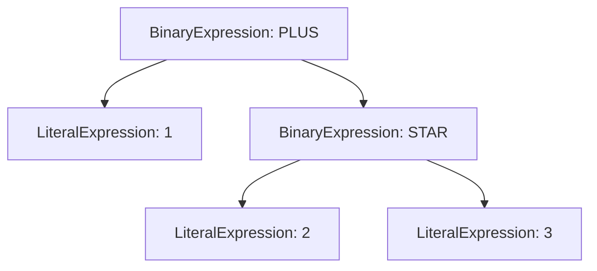
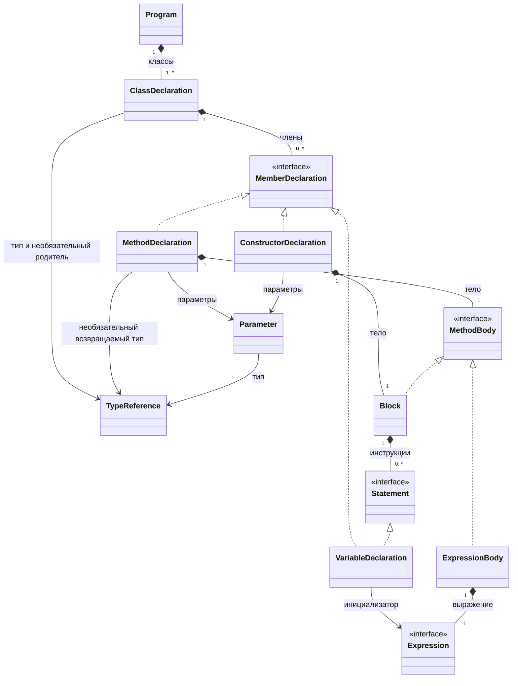
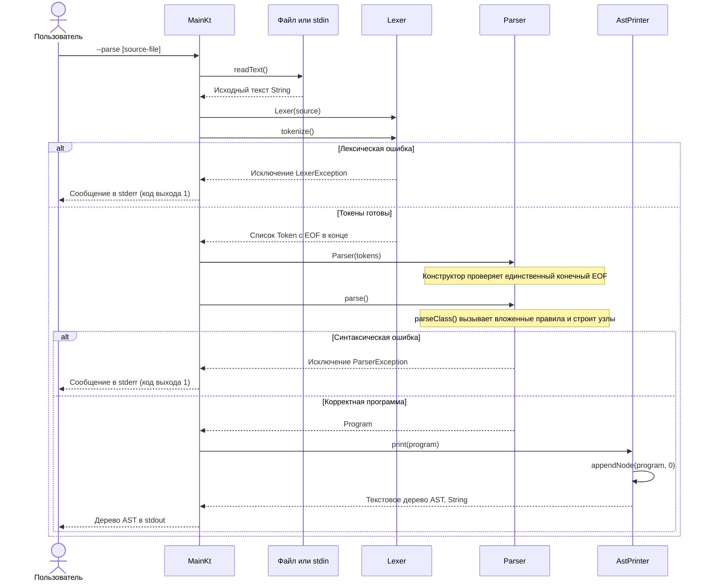

# Компилятор O команды Niiby

Учебный проект по разработке компилятора на Kotlin. Лексер разбивает исходный код языка O на токены, а синтаксический анализатор строит абстрактное синтаксическое дерево (AST). Семантический анализ и генерация кода Jasmin запланированы на следующие этапы.

- [Быстрый запуск](#быстрый-запуск)
- [Разбор кода](#разбор-кода)
- [UML-диаграммы классов](#uml-диаграммы-классов)
- [Диаграмма последовательности для режима разбора](#диаграмма-последовательности-для-режима-разбора)
- [Реализованная грамматика](#реализованная-грамматика)
- [Проверка](#проверка)

## Требования

- JDK 25
- Maven 3.9 или новее

Проект использует Kotlin 2.3.0 и собирается для Java 25. [Kotlin 2.3.0 поддерживает байткод Java 25](https://kotlinlang.org/docs/whatsnew23.html#kotlin-jvm-support-for-java-25). Чтобы выбрать установленный JDK 25 на macOS:

```bash
export JAVA_HOME=$(/usr/libexec/java_home -v 25)
```

В IntelliJ IDEA выберите JDK 25 как SDK проекта и среду запуска Maven. При первой сборке Maven загрузит компилятор Kotlin и зависимости для тестов.

## Быстрый запуск

```bash
make test
make run                         # Разбить examples/demo.o на токены
make parse                       # Разобрать examples/demo.o и вывести AST
make parse FILE=examples/syntax.o # Разобрать расширенный пример синтаксиса
make help
```

В `examples/syntax.o` показаны наследование, конструкторы, методы, вложенные циклы и условия, обобщённые типы и расширение `for`, добавленное командой.

## Режимы командной строки

По умолчанию программа выводит токены:

```bash
make run FILE=path/to/program.o
make tokens FILE=path/to/program.o OUT=results/program.tokens
make stdin
```

Чтобы разобрать файл и вывести или сохранить AST:

```bash
make parse FILE=path/to/program.o
make ast FILE=path/to/program.o OUT=results/program.ast
```

По умолчанию `FILE` указывает на `examples/demo.o`. Команда `make tokens` сохраняет результат в `tokens.txt`, а `make ast` записывает дерево в `ast.txt`.

Точка входа принимает аргументы `[--tokens|--parse] [source-file]`. Если файл не указан, программа читает стандартный ввод:

```bash
printf 'class Empty is end\n' | mvn -q compile exec:java -Dexec.args="--parse"
mvn -q compile exec:java -Dexec.args="--help"
```

В выводе AST у каждого узла указаны строка и столбец его начала:

```text
Program @ 1:1
  Class Empty @ 1:1
    Type Empty @ 1:7
```

Вызов через Kotlin API: `Parser(Lexer(source).tokenize()).parse()`. Каждый узел AST хранит полный диапазон исходного текста, включая смещения и конечную позицию.

## Поддерживаемый синтаксис

- Классы с необязательным наследованием и вложенными аргументами обобщённых типов
- Поля и локальные переменные с инициализацией `var name : expression`
- Конструкторы и методы с необязательными списками типизированных параметров
- Тела методов в форме `is ... end` или `=> expression`
- Присваивание, `while`, `if`/`else`, `return` и `for name in expression loop ... end`
- Целочисленные, вещественные и логические литералы; имена; `this`; доступ к членам; цепочки вызовов и вызовы конструкторов с аргументами типов
- Арифметические операции, сравнения, унарные `+`/`-` и скобки

Парсер использует рекурсивный спуск. Операторы разбираются с учётом приоритета, а бинарные операции одного уровня группируются слева направо.

Локальные лекции объясняют синтаксический анализ и построение AST, но не содержат формальной спецификации языка O.

## Обработка ошибок

При лексической или синтаксической ошибке программа сообщает строку и столбец и завершается с кодом `1`. Ошибка чтения файла также возвращает код `1`. Неверные аргументы командной строки возвращают код `2`.

```text
Lexical error: Unexpected character '@' at 2:17
```

Сообщения о синтаксических ошибках описывают ожидаемую конструкцию и указывают позицию ошибки. Если отсутствует нужный токен, сообщение также называет неожиданный токен или конец ввода. Парсер останавливается на первой ошибке. Разрешение имён, проверка типов, повторных объявлений и возвращаемого типа относятся к семантическому анализу.

## Разбор кода

### Точка входа и передача данных

[`Main.kt`](src/main/kotlin/team/niiby/compiler/Main.kt) читает файл или стандартный ввод и вызывает `Lexer(source).tokenize()`. В режиме токенов функция `printTokens()` выводит тип, начальную позицию и лексему каждого токена. В режиме разбора токены передаются в `Parser`, после чего полученный узел `Program` передаётся в `AstPrinter`:

```kotlin
val tokens = Lexer(source).tokenize()
val program = Parser(tokens).parse()
val outline = AstPrinter().print(program)
print(outline)
```

Лексер распознаёт слова, числа и знаки. Парсер проверяет, как токены образуют объявления, инструкции и выражения. `AstPrinter` выводит дерево в текстовом виде. На этих этапах программа на языке O ещё не выполняется.

### Лексер: из исходного текста в токены

[`Lexer.kt`](src/main/kotlin/team/niiby/compiler/lexer/Lexer.kt) хранит исходную строку и текущую позицию: `index`, `line` и `column`. Функция `tokenize()` повторяет следующие действия:

1. `skipTrivia()` пропускает пробельные символы, комментарии `//` и `/* ... */`.
2. Запоминает начальную позицию следующего токена.
3. Читает токен через `scanIdentifier()`, `scanNumber()` или `scanSymbol()`.
4. `token()` сохраняет тип токена, исходный текст и диапазон позиций.
5. В конце исходного текста добавляет один токен `EOF` с пустой лексемой и диапазоном нулевой длины.

`scanIdentifier()` принимает букву или подчёркивание в начале имени, затем буквы, цифры и подчёркивания. Прочитанное слово проверяется по таблице `KEYWORDS`. Ключевые слова чувствительны к регистру; `true` и `false` превращаются в токены `BOOLEAN_LITERAL`.

`scanNumber()` читает целую часть, необязательную дробную часть и необязательную экспоненту. Точка входит в вещественный литерал только тогда, когда за ней идёт цифра. Поэтому `2.Plus(3)` разбирается как целое число с последующим обращением к члену. В экспоненте нужна хотя бы одна цифра: для `12e+` лексер выбросит `LexerException` на позиции `e`.

`scanSymbol()` сначала проверяет двухсимвольные операторы, например `:=`, `=>` и `<=`, затем одиночные символы. Это правило максимального захвата (maximal munch): выбирается самый длинный подходящий токен. Неизвестный символ вызывает `LexerException`; незакрытый блочный комментарий сообщает позицию своего начала.

`advance()` обновляет все поля текущей позиции. LF, CR и CRLF считаются переносами строки, причём CRLF увеличивает номер строки один раз. Типы токенов и позиций описаны в [`Token.kt`](src/main/kotlin/team/niiby/compiler/lexer/Token.kt), а полный набор типов токенов приведён в [`TokenType.kt`](src/main/kotlin/team/niiby/compiler/lexer/TokenType.kt).

### Парсер: из токенов в AST

[`Parser.kt`](src/main/kotlin/team/niiby/compiler/parser/Parser.kt) хранит список токенов и собственный `index`. Конструктор требует ровно один `EOF` в конце списка. Если через Kotlin API передан некорректный список, возникает `IllegalArgumentException`.

`parse()` разбирает один или несколько классов и возвращает `Program`. После разбора текущим токеном остаётся конечный `EOF`. Пустая программа вызывает ошибку. Если после класса есть другие токены, они должны образовать ещё одно полное объявление класса.

Правило выбирается по текущему токену. Члены класса разбираются функциями `parseVariable()` для `var`, `parseMethod()` для `method` и `parseConstructor()` для `this`. Каждая функция читает свою конструкцию и возвращает узел AST. Парсер написан вручную и сразу строит AST, без генератора парсера и промежуточного дерева разбора.

| Функции | Что читают и строят |
| --- | --- |
| `parseClass()` | Тип класса, необязательного родителя, члены и закрывающий `end` |
| `parseType()`, `parseTypeArguments()` | Имя типа и рекурсивно вложенные аргументы обобщённых типов |
| `parseVariable()` | `var name : expression` для поля или локальной переменной |
| `parseParameters()` | Необязательный список параметров; у каждого есть имя и тип |
| `parseMethod()` | Имя метода, параметры, необязательный возвращаемый тип и тело в виде блока или выражения |
| `parseConstructor()` | `this`, параметры и блок `is ... end` |
| `parseBlock()`, `parseStatement()` | Инструкции до `end` или до `else` при разборе ветви условия |
| `parseWhile()`, `parseFor()`, `parseIf()` | Условие или перебираемое выражение, вложенные блоки и закрывающие ключевые слова |
| `parseReturn()`, `canStartExpression()` | `return` и необязательное возвращаемое значение |
| `parseExpressionStatement()` | Выражение, за которым могут следовать `:=` и присваиваемое значение |
| `parseExpression()` и функции приоритетов | Вложенные узлы выражений с учётом приоритета операторов |

Вспомогательные функции управляют чтением токенов. `peek()` и `previous()` смотрят текущий и предыдущий токены; `advance()` читает токен и сдвигает позицию; `check()` проверяет тип без сдвига. `match()` читает необязательный токен, если он подошёл. `consume()` требует токен заданного типа или вызывает `fail()`. Функция `fail()` выбрасывает `ParserException` с позицией неожиданного токена.

Присваивание относится к инструкциям. Слева должен быть `NameExpression` без аргументов типов или `MemberExpression`. Цели вроде `1`, `Call()`, `(value)` и `this` отклоняются. Семантический анализ позже определит, можно ли изменять значение, на которое ссылается имя или член.

### Приоритет выражений

`parseExpression()` вызывает `parseEquality()`. Каждый уровень передаёт разбор своих операндов следующему уровню с более высоким приоритетом:

| Приоритет, начиная с низшего | Функция | Синтаксис |
| --- | --- | --- |
| 1 | `parseEquality()` | `==` |
| 2 | `parseComparison()` | `<`, `>`, `<=`, `>=` |
| 3 | `parseAddition()` | `+`, `-` |
| 4 | `parseMultiplication()` | `*`, `/` |
| 5 | `parseUnary()` | Унарные `+`, `-` |
| 6 | `parsePostfix()` | Доступ к членам и вызовы |
| 7 | `parsePrimary()` | Литералы, имена с необязательными аргументами типов, `this` и выражения в скобках |

Бинарные операции четырёх уровней разбираются общей функцией `parseBinary()`. Она читает левый операнд, затем в цикле объединяет накопленное выражение с очередным оператором и правым операндом. Так получается левая ассоциативность: `a - b - c` превращается в `(a - b) - c`.

`parseUnary()` рекурсивно читает унарные операторы. `parsePostfix()` последовательно оборачивает выражение в узлы доступа к члену или вызова. Поэтому цепочка `this.factory().Build(2.Plus(3)).value` сохраняет всю вложенную структуру. Скобки создают узел `GroupedExpression`, который хранит группировку и её диапазон в исходном тексте.

Для `1 + 2 * 3` умножение становится правым дочерним узлом сложения:



### Узлы AST и позиции в исходном тексте

[`Ast.kt`](src/main/kotlin/team/niiby/compiler/parser/Ast.kt) определяет классы данных Kotlin и интерфейсы `sealed`. Через `AstNode` каждый узел получает `SourceSpan`. Интерфейсы задают, где может находиться узел:

| Роль | Типы узлов |
| --- | --- |
| Структура программы и типов | `Program`, `ClassDeclaration`, `TypeReference`, `Parameter` |
| `MemberDeclaration` | `VariableDeclaration`, `MethodDeclaration`, `ConstructorDeclaration` |
| `Statement` | `VariableDeclaration`, `AssignmentStatement`, `WhileStatement`, `ForStatement`, `IfStatement`, `ReturnStatement`, `ExpressionStatement` |
| `MethodBody` | `Block`, `ExpressionBody` |
| `Expression` | `NameExpression`, `ThisExpression`, `LiteralExpression`, `MemberExpression`, `CallExpression`, `UnaryExpression`, `BinaryExpression`, `GroupedExpression` |

`VariableDeclaration` реализует и `MemberDeclaration`, и `Statement`, поэтому поля и локальные переменные используют один тип узла. `Block` реализует `MethodBody` и содержит инструкции. Тело метода хранится как `Block` или `ExpressionBody`; тело конструктора всегда хранится как `Block`. В `TypeReference.arguments` находятся вложенные ссылки на типы, а в `NameExpression.typeArguments` хранятся аргументы типов у имени в выражении.

Литералы сохраняют тип токена и исходную лексему. Парсер не преобразует большое целое число в машинный целочисленный тип и не вычисляет выражения. Вызов `Counter(0)` остаётся узлом `CallExpression(NameExpression("Counter"), ...)`. Чтобы определить, вызывается ли конструктор, нужно разрешить имя `Counter`.

`SourcePosition` хранит смещение в исходной строке Kotlin, начиная с нуля, и номера строки и столбца, начиная с единицы. `SourceSpan` задаёт полуоткрытый диапазон: позиция `start` входит в него, а `end` исключается. Диапазон токена охватывает исходную лексему, а диапазон узла AST охватывает соответствующую конструкцию. Классы, конструкторы, методы с блоком и инструкции управления потоком включают закрывающий `end` в свой диапазон. Диапазон `Block` охватывает только его инструкции; у пустого блока он имеет нулевую длину на позиции завершающего токена.

[`AstPrinter.kt`](src/main/kotlin/team/niiby/compiler/parser/AstPrinter.kt) рекурсивно обходит дерево через `appendNode()`. Для каждого узла выбирает подпись и дочерние узлы, добавляет по два пробела на уровень вложенности и выводит начальную строку и столбец. Сам AST также хранит смещения и конечные позиции, которые не попадают в текстовый вывод.

### Разбор примера

Этот исходный код также используется в тесте вывода AST:

```text
class Example is
    method value => 1 + 2 * 3
end
```

Лексер выдаёт последовательность токенов:

```text
CLASS IDENTIFIER IS METHOD IDENTIFIER FAT_ARROW
INTEGER_LITERAL PLUS INTEGER_LITERAL STAR INTEGER_LITERAL END EOF
```

Парсер строит класс с методом, тело которого задано выражением. `AstPrinter` выводит:

```text
Program @ 1:1
  Class Example @ 1:1
    Type Example @ 1:7
    Method value @ 2:5
      Expression body @ 2:18
        Binary PLUS @ 2:21
          Literal 1 @ 2:21
          Binary STAR @ 2:25
            Literal 2 @ 2:25
            Literal 3 @ 2:29
```

## UML-диаграммы классов

### Компоненты компилятора

Диаграмма показывает структуру токенов и классы, которые строят и выводят AST. Сплошные стрелки обозначают хранимые ссылки, пунктирные показывают зависимости.

```mermaid
classDiagram
    direction LR
    class Lexer {
        -String source
        -Int index
        +tokenize() List~Token~
    }
    class Parser {
        -List~Token~ tokens
        -Int index
        +parse() Program
    }
    class Token {
        +TokenType type
        +String lexeme
        +SourceSpan span
    }
    class TokenType {
        <<enumeration>>
    }
    class SourceSpan {
        +SourcePosition start
        +SourcePosition end
    }
    class SourcePosition {
        +Int offset
        +Int line
        +Int column
    }
    class Program {
        +List~ClassDeclaration~ classes
        +SourceSpan span
    }
    class AstPrinter {
        +print(Program) String
    }
    Lexer ..> Token : создаёт
    Parser --> Token : читает токены
    Token --> TokenType : тип
    Token --> SourceSpan : диапазон
    SourceSpan --> SourcePosition : начало и конец
    Parser ..> Program : строит
    Program --> SourceSpan : диапазон
    AstPrinter ..> Program : обходит
```



### Структура AST

Здесь показаны объявления, тела методов и связи с инструкциями. Все реализации выражений и инструкций перечислены в таблице выше. Каждый тип на диаграмме реализует `AstNode` напрямую или через интерфейс.



Стрелка `<|..` означает реализацию интерфейса классом данных. Связь `*--` обозначает вложенность узлов AST, а числа рядом со связями показывают количество дочерних узлов, которое создаёт парсер.

## Диаграмма последовательности для режима разбора

Последовательность соответствует запуску `Main.kt` с аргументом `--parse`. В режиме токенов программа завершается после их вывода, без вызовов парсера и принтера AST. Ошибки чтения файла обрабатываются до запуска лексера.



Например, `var value : end` внутри класса успешно разбивается на токены, но `parseVariable()` ожидает выражение после `:`. Парсер обнаруживает ошибку на `end`, и программа выводит сообщение о синтаксической ошибке вместо AST.

## Реализованная грамматика

Ниже правила реализованного синтаксиса в форме EBNF. Квадратные скобки обозначают необязательную часть, фигурные скобки обозначают повторение, а текст в кавычках соответствует токену исходного кода. `identifier`, `literal` и `EOF` поступают от лексера; литералы бывают целочисленными, вещественными и логическими.

```ebnf
program       = classDecl, { classDecl }, EOF ;
classDecl     = "class", type, [ "extends", type ], "is",
                { variable | constructor | method }, "end" ;
type          = identifier, [ "[", type, { ",", type }, "]" ] ;
variable      = "var", identifier, ":", expression ;
parameters    = "(", [ parameter, { ",", parameter } ], ")" ;
parameter     = identifier, ":", type ;
constructor   = "this", [ parameters ], "is", body, "end" ;
method        = "method", identifier, [ parameters ], [ ":", type ],
                ( "is", body, "end" | "=>", expression ) ;
body          = { variable | statement } ;
statement     = assignment | whileStmt | ifStmt | forStmt
                | returnStmt | expression ;
assignment    = assignable, ":=", expression ;
whileStmt     = "while", expression, "loop", body, "end" ;
ifStmt        = "if", expression, "then", body,
                [ "else", body ], "end" ;
forStmt       = "for", identifier, "in", expression, "loop", body, "end" ;
returnStmt    = "return", [ expression ] ;

expression    = equality ;
equality      = comparison, { "==", comparison } ;
comparison    = addition, { ( "<" | ">" | "<=" | ">=" ), addition } ;
addition      = product, { ( "+" | "-" ), product } ;
product       = unary, { ( "*" | "/" ), unary } ;
unary         = ( "+" | "-" ), unary | postfix ;
postfix       = primary, { ".", identifier | arguments } ;
primary       = literal | type | "this" | "(", expression, ")" ;
arguments     = "(", [ expression, { ",", expression } ], ")" ;
```

`assignable` обозначает имя без аргументов типов или выражение доступа к члену. Это ограничение проверяет `parseExpressionStatement()`. Форма `type` в выражении создаёт `NameExpression` с необязательными аргументами типов. Квадратные скобки в исходном коде используются для аргументов типов; индексация массивов в эту грамматику не входит.

Лексер пропускает пробельные символы и комментарии, включая переносы строк. Поэтому границы инструкций определяются по токенам. Значение после `return` читается всякий раз, когда следующий токен может начать выражение, даже на следующей строке. Возврат без значения заканчивается перед `end`, `else` или другим токеном, который не может начать выражение.

Синтаксис типизированных параметров, обобщённых типов, методов с блоками, присваивания членам и цикла `for` выбран на основе существующего лексера и примеров проекта. Когда станет доступна спецификация языка O для курса, эти правила нужно будет сверить с ней. Разрешение имён, проверка типов, генерация кода и продолжение разбора после ошибки остаются для следующих этапов.

## Проверка

Запустить тесты Maven можно командами `make test` или `mvn test`. Сейчас в наборе 54 теста:

| Файл тестов | Количество | Что проверяется |
| --- | --- | --- |
| [`LexerTest.kt`](src/test/kotlin/team/niiby/compiler/lexer/LexerTest.kt) | 19 | Ключевые слова, литералы, символы, комментарии, позиции и лексические ошибки |
| [`ParserTest.kt`](src/test/kotlin/team/niiby/compiler/parser/ParserTest.kt) | 34 | Структура AST, объявления, вложенные циклы и условия, приоритеты, цепочки вызовов, диапазоны, EOF и синтаксические ошибки |
| [`AstPrinterTest.kt`](src/test/kotlin/team/niiby/compiler/parser/AstPrinterTest.kt) | 1 | Точный вывод дерева и позиции узлов для разобранного примера |

Тесты также разбирают файлы примеров. Они проверяют типы узлов, дочерние узлы и соответствующие участки исходного текста. Одной проверки успешного разбора недостаточно, чтобы обнаружить ошибку в структуре AST.

## Структура репозитория

```text
examples/
  demo.o                   Исходный пример для лексера
  syntax.o                 Пример для синтаксического анализатора
src/main/kotlin/team/niiby/compiler/
  Main.kt                  Режимы вывода токенов и AST
  lexer/                   Лексер, токены и позиции в исходном тексте
  parser/
    Ast.kt                 Классы данных AST
    Parser.kt              Парсер на основе рекурсивного спуска
    ParserException.kt     Синтаксические ошибки
    AstPrinter.kt          Текстовое представление AST
src/test/kotlin/team/niiby/compiler/
  lexer/                   Тесты лексера
  parser/                  Тесты парсера и вывода AST
Makefile                   Команды сборки, проверки и запуска
pom.xml                    Конфигурация Maven
```

PDF лекций и презентация по лексеру хранятся локально как справочные материалы и игнорируются Git.
