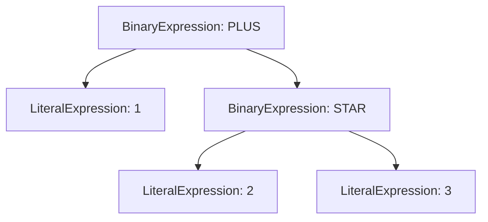
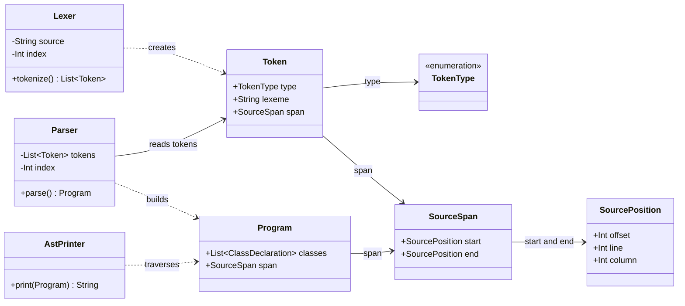
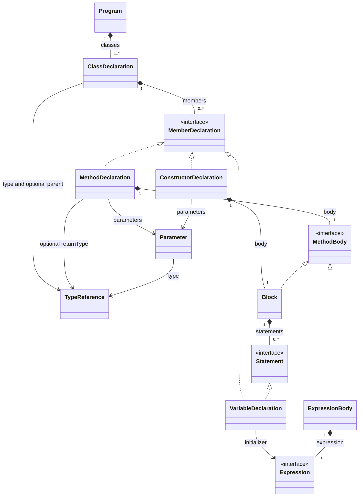
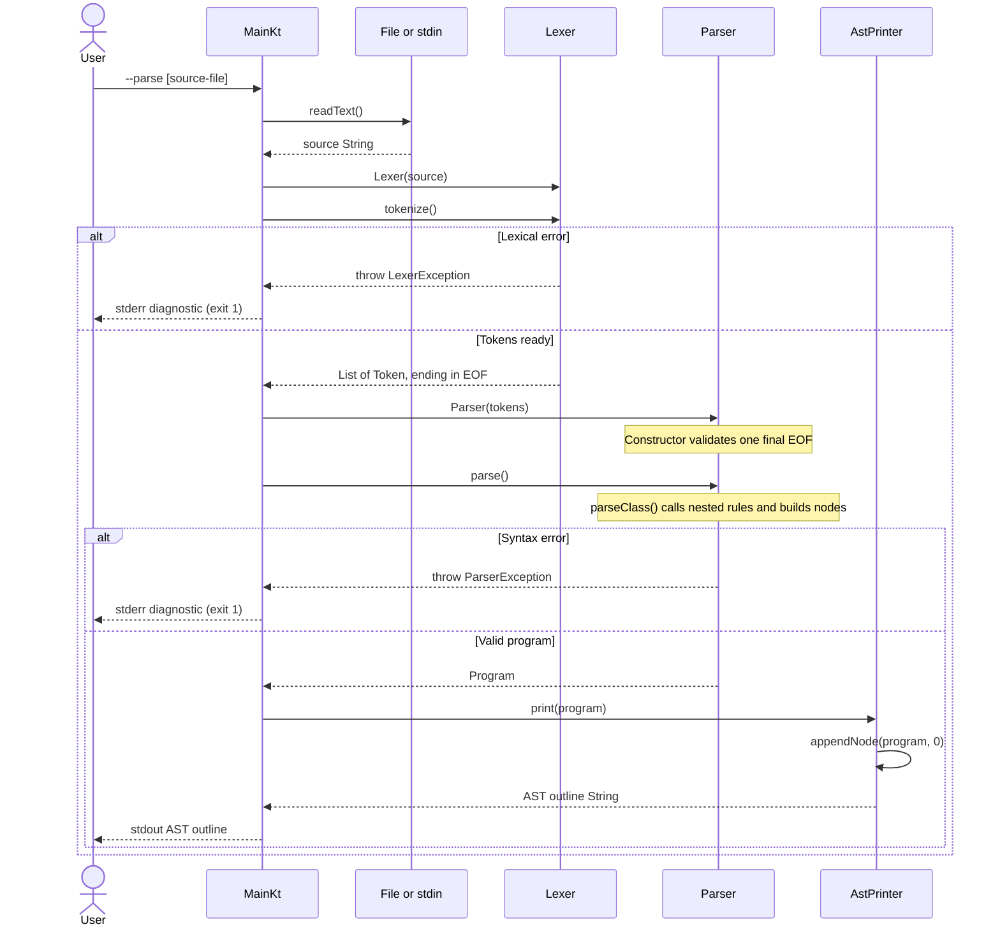

# Niiby O Compiler

A compiler construction course project written in Kotlin. The lexer converts O source code into tokens, and the syntax analyzer builds an abstract syntax tree (AST). Semantic analysis and Jasmin code generation are planned for later stages.

- [Quick start](#quick-start)
- [Code walkthrough](#code-walkthrough)
- [UML class diagrams](#uml-class-diagrams)
- [Parse-mode sequence](#parse-mode-sequence)
- [Implemented grammar](#implemented-grammar)
- [Verification](#verification)

## Requirements

- JDK 25
- Maven 3.9 or newer

The project uses Kotlin 2.3.0 and targets Java 25. [Kotlin 2.3.0 supports Java 25 bytecode](https://kotlinlang.org/docs/whatsnew23.html#kotlin-jvm-support-for-java-25). To select an installed JDK 25 on macOS:

```bash
export JAVA_HOME=$(/usr/libexec/java_home -v 25)
```

Use JDK 25 as the project SDK and Maven runtime in IntelliJ IDEA. Maven downloads the Kotlin compiler and test dependencies during the first build.

## Quick start

```bash
make test
make run                         # Tokenize examples/demo.o
make parse                       # Parse examples/demo.o and print its AST
make parse FILE=examples/syntax.o # Parse the larger syntax example
make help
```

`examples/syntax.o` includes inheritance, constructors, methods, nested control flow, generic types, and the team's `for` extension.

## Command-line modes

The default mode prints tokens:

```bash
make run FILE=path/to/program.o
make tokens FILE=path/to/program.o OUT=results/program.tokens
make stdin
```

Parse a file and inspect or save its AST:

```bash
make parse FILE=path/to/program.o
make ast FILE=path/to/program.o OUT=results/program.ast
```

`FILE` defaults to `examples/demo.o`. The default output file is `tokens.txt` for `make tokens` and `ast.txt` for `make ast`.

The entry point accepts `[--tokens|--parse] [source-file]`. Without a file, it reads standard input:

```bash
printf 'class Empty is end\n' | mvn -q compile exec:java -Dexec.args="--parse"
mvn -q compile exec:java -Dexec.args="--help"
```

AST output includes each node's starting line and column:

```text
Program @ 1:1
  Class Empty @ 1:1
    Type Empty @ 1:7
```

The Kotlin API is `Parser(Lexer(source).tokenize()).parse()`. Every AST node retains its full source span, including offsets and end positions.

## Supported syntax

- Classes with optional inheritance and nested generic type arguments
- Fields and local variables initialized with `var name : expression`
- Constructors and methods with optional typed parameter lists
- Method bodies written as `is ... end` or `=> expression`
- Assignment, `while`, `if`/`else`, `return`, and `for name in expression loop ... end`
- Integer, real, and boolean literals; names; `this`; member access; chained calls; and generic constructor calls
- Arithmetic and comparison operators, unary `+`/`-`, and parentheses

The parser uses recursive descent. Operators are parsed in precedence order, and binary operators at the same level associate to the left.

The local lectures explain parsing and AST construction but do not provide a formal O language specification.

## Error handling

Lexical and syntax errors report a line and column and exit with status `1`. File-reading errors also exit with status `1`; invalid command-line arguments exit with status `2`.

```text
Lexical error: Unexpected character '@' at 2:17
```

Syntax diagnostics describe the expected structure and report the error position. Missing-token errors also identify the unexpected token or end of input. The parser stops at the first error. Name resolution, type checking, duplicate declarations, and return-type validation belong to semantic analysis.

## Code walkthrough

### Entry point and data flow

[`Main.kt`](src/main/kotlin/team/niiby/compiler/Main.kt) reads a file or standard input and calls `Lexer(source).tokenize()`. In token mode, `printTokens()` prints each token's type, starting position, and lexeme. In parse mode, it passes the tokens to `Parser`, then passes the resulting `Program` to `AstPrinter`:

```kotlin
val tokens = Lexer(source).tokenize()
val program = Parser(tokens).parse()
val outline = AstPrinter().print(program)
print(outline)
```

The lexer recognizes words, numbers, and punctuation. The parser checks how those tokens form declarations, statements, and expressions. `AstPrinter` turns the tree into text for inspection. None of these steps executes the O program.

### Lexer: source text to tokens

[`Lexer.kt`](src/main/kotlin/team/niiby/compiler/lexer/Lexer.kt) stores the source string and a cursor: `index`, `line`, and `column`. `tokenize()` repeats these steps:

1. `skipTrivia()` skips whitespace, `//` comments, and `/* ... */` comments.
2. It records the next token's starting position.
3. `scanIdentifier()`, `scanNumber()`, or `scanSymbol()` reads the token.
4. `token()` stores its type, original text, and source span.
5. At the end of the source, it appends one `EOF` token with an empty lexeme and a zero-length span.

`scanIdentifier()` accepts a letter or underscore first, followed by letters, digits, or underscores. It checks the complete word against `KEYWORDS`. Keywords are case-sensitive; `true` and `false` become `BOOLEAN_LITERAL` tokens.

`scanNumber()` reads an integer, an optional fractional part, and an optional exponent. A dot belongs to a real number only when the next character is a digit. This keeps `2.Plus(3)` as an integer followed by member access. Exponents require at least one digit; `12e+` raises `LexerException` at the `e`.

`scanSymbol()` checks two-character operators such as `:=`, `=>`, and `<=` before single-character symbols. This rule is called maximal munch: it selects the longer matching token. An unknown character raises `LexerException`; an unclosed block comment reports the comment's starting position.

`advance()` updates all cursor fields. It treats LF, CR, and CRLF as line breaks, with CRLF counting as one newline. The token and position types are defined in [`Token.kt`](src/main/kotlin/team/niiby/compiler/lexer/Token.kt), and the vocabulary is listed in [`TokenType.kt`](src/main/kotlin/team/niiby/compiler/lexer/TokenType.kt).

### Parser: tokens to an AST

[`Parser.kt`](src/main/kotlin/team/niiby/compiler/parser/Parser.kt) stores the token list and its own `index`. Its constructor requires exactly one `EOF`, at the end of the list. Invalid token lists supplied through the Kotlin API raise `IllegalArgumentException`.

`parse()` parses one or more classes and returns `Program`. It stops with the cursor at the final `EOF`. Empty input fails, and any token after the last class must begin another complete class declaration.

The parser chooses a rule from the current token. A class member beginning with `var` calls `parseVariable()`, `method` calls `parseMethod()`, and `this` calls `parseConstructor()`. Each function reads its syntax and returns an AST node. The implementation uses handwritten functions, with no parser generator or separate parse-tree stage.

| Functions | What they read and build |
| --- | --- |
| `parseClass()` | Class type, optional parent, members, and the closing `end` |
| `parseType()`, `parseTypeArguments()` | A type name and recursively nested generic arguments |
| `parseVariable()` | `var name : expression`, used for both fields and local variables |
| `parseParameters()` | An optional parameter list; each parameter has a name and type |
| `parseMethod()` | Method name, parameters, optional return type, and a block or expression body |
| `parseConstructor()` | `this`, parameters, and an `is ... end` block |
| `parseBlock()`, `parseStatement()` | Statements until `end`, or until `else` when parsing an if branch |
| `parseWhile()`, `parseFor()`, `parseIf()` | A condition or iterable, nested blocks, and their closing keywords |
| `parseReturn()`, `canStartExpression()` | `return` and its optional value |
| `parseExpressionStatement()` | An expression, optionally followed by `:=` and an assigned value |
| `parseExpression()` and the precedence functions | Nested expression nodes in operator-precedence order |

The cursor helpers keep token handling in one place. `peek()` and `previous()` inspect tokens; `advance()` consumes one; `check()` compares its type without consuming it. `match()` consumes an optional token, while `consume()` requires a token or calls `fail()`. `fail()` throws `ParserException` with the unexpected token's position.

Assignment is a statement. Its target must be a `NameExpression` without generic arguments or a `MemberExpression`. Targets such as `1`, `Call()`, `(value)`, and `this` are rejected. Whether a name or member refers to a writable value is a later semantic check.

### Expression precedence

`parseExpression()` calls `parseEquality()`. Each level delegates its operands to the next, tighter level:

| Priority, lowest first | Function | Syntax |
| --- | --- | --- |
| 1 | `parseEquality()` | `==` |
| 2 | `parseComparison()` | `<`, `>`, `<=`, `>=` |
| 3 | `parseAddition()` | `+`, `-` |
| 4 | `parseMultiplication()` | `*`, `/` |
| 5 | `parseUnary()` | Prefix `+`, `-` |
| 6 | `parsePostfix()` | Member access and calls |
| 7 | `parsePrimary()` | Literals, names with optional type arguments, `this`, and grouped expressions |

The four binary levels share `parseBinary()`. It reads a left operand, then repeatedly combines the accumulated expression with an operator and a right operand. This gives left associativity: `a - b - c` becomes `(a - b) - c`.

`parseUnary()` recursively reads prefix operators. `parsePostfix()` repeatedly wraps an expression in member-access or call nodes, so chains such as `this.factory().Build(2.Plus(3)).value` retain their full structure. Parentheses create `GroupedExpression`, preserving both the grouping and its source span.

For `1 + 2 * 3`, multiplication becomes the right child of addition:



### AST nodes and source positions

[`Ast.kt`](src/main/kotlin/team/niiby/compiler/parser/Ast.kt) defines Kotlin data classes and sealed interfaces. `AstNode` gives every node a `SourceSpan`. The interfaces describe where each node can appear:

| Role | Node types |
| --- | --- |
| Program and type structure | `Program`, `ClassDeclaration`, `TypeReference`, `Parameter` |
| `MemberDeclaration` | `VariableDeclaration`, `MethodDeclaration`, `ConstructorDeclaration` |
| `Statement` | `VariableDeclaration`, `AssignmentStatement`, `WhileStatement`, `ForStatement`, `IfStatement`, `ReturnStatement`, `ExpressionStatement` |
| `MethodBody` | `Block`, `ExpressionBody` |
| `Expression` | `NameExpression`, `ThisExpression`, `LiteralExpression`, `MemberExpression`, `CallExpression`, `UnaryExpression`, `BinaryExpression`, `GroupedExpression` |

`VariableDeclaration` implements both `MemberDeclaration` and `Statement`, so fields and local variables share a node type. `Block` implements `MethodBody` and contains statements. A method holds either a `Block` or an `ExpressionBody`; a constructor always holds a `Block`. `TypeReference.arguments` stores nested type references, while `NameExpression.typeArguments` stores generic arguments on a name used in an expression.

Literals retain their token kind and original lexeme. Parsing does not convert a large integer to a machine integer or evaluate an expression. A call such as `Counter(0)` remains `CallExpression(NameExpression("Counter"), ...)`; deciding whether it calls a constructor requires name resolution.

`SourcePosition` contains a zero-based offset into the Kotlin source string and one-based line and column numbers. `SourceSpan` is half-open: it includes `start` and excludes `end`. Token spans cover the original lexeme; AST spans cover the source represented by each node. Classes, constructors, block methods, and control-flow statements include their closing `end` in their spans. A `Block` span covers only its statements; an empty block has a zero-length span at its terminator.

[`AstPrinter.kt`](src/main/kotlin/team/niiby/compiler/parser/AstPrinter.kt) recursively visits the tree through `appendNode()`. It selects a label and children for each node, adds two spaces per nesting level, and prints the starting line and column. The AST retains offsets and end positions even though the outline displays only starting positions.

### Worked example

This source is also used by the AST-output regression test:

```text
class Example is
    method value => 1 + 2 * 3
end
```

The lexer emits:

```text
CLASS IDENTIFIER IS METHOD IDENTIFIER FAT_ARROW
INTEGER_LITERAL PLUS INTEGER_LITERAL STAR INTEGER_LITERAL END EOF
```

The parser builds a class containing an expression-bodied method. `AstPrinter` prints:

```text
Program @ 1:1
  Class Example @ 1:1
    Type Example @ 1:7
    Method value @ 2:5
      Expression body @ 2:18
        Binary PLUS @ 2:21
          Literal 1 @ 2:21
          Binary STAR @ 2:25
            Literal 2 @ 2:25
            Literal 3 @ 2:29
```

## UML class diagrams

### Compiler components

The class diagram shows the token API and the classes that build and print the AST. Solid arrows show stored references; dotted arrows show dependencies.



### AST structure

This diagram focuses on declarations, method bodies, and statement ownership. The table above lists all expression and statement implementations. Every type shown here implements `AstNode`, directly or through an interface.



`<|..` means that a data class implements an interface. `*--` marks containment in the AST, and multiplicities show how many children the parser places in a node.

## Parse-mode sequence

This sequence follows `Main.kt` for `--parse`. Token mode returns after printing the token list and never invokes the parser or AST printer. File-reading errors are handled before lexing.



For example, `var value : end` inside a class tokenizes successfully, but `parseVariable()` expects an expression after `:`. The parser fails at `end`, and the CLI prints a syntax diagnostic instead of an AST.

## Implemented grammar

This EBNF describes the implemented rules. Brackets mean an optional part, braces mean repetition, and quoted text is a source token. `identifier`, `literal`, and `EOF` come from the lexer; literals are integer, real, or boolean tokens.

```ebnf
program       = classDecl, { classDecl }, EOF ;
classDecl     = "class", type, [ "extends", type ], "is",
                { variable | constructor | method }, "end" ;
type          = identifier, [ "[", type, { ",", type }, "]" ] ;
variable      = "var", identifier, ":", expression ;
parameters    = "(", [ parameter, { ",", parameter } ], ")" ;
parameter     = identifier, ":", type ;
constructor   = "this", [ parameters ], "is", body, "end" ;
method        = "method", identifier, [ parameters ], [ ":", type ],
                ( "is", body, "end" | "=>", expression ) ;
body          = { variable | statement } ;
statement     = assignment | whileStmt | ifStmt | forStmt
                | returnStmt | expression ;
assignment    = assignable, ":=", expression ;
whileStmt     = "while", expression, "loop", body, "end" ;
ifStmt        = "if", expression, "then", body,
                [ "else", body ], "end" ;
forStmt       = "for", identifier, "in", expression, "loop", body, "end" ;
returnStmt    = "return", [ expression ] ;

expression    = equality ;
equality      = comparison, { "==", comparison } ;
comparison    = addition, { ( "<" | ">" | "<=" | ">=" ), addition } ;
addition      = product, { ( "+" | "-" ), product } ;
product       = unary, { ( "*" | "/" ), unary } ;
unary         = ( "+" | "-" ), unary | postfix ;
postfix       = primary, { ".", identifier | arguments } ;
primary       = literal | type | "this" | "(", expression, ")" ;
arguments     = "(", [ expression, { ",", expression } ], ")" ;
```

`assignable` means a name without generic arguments or a member-access expression, as checked by `parseExpressionStatement()`. The `type` form in an expression creates a `NameExpression` with optional type arguments. Square brackets hold generic arguments; array indexing is outside this grammar.

The lexer discards whitespace and comments, including line breaks. Statement boundaries therefore come from tokens. A value after `return` is consumed whenever the next token can start an expression, even on the next line. A bare return ends before `end`, `else`, or another token that cannot start an expression.

Typed parameters, generics, full method bodies, member assignment, and the `for` form are project grammar choices inferred from the existing lexer and examples. They need comparison with the course's O specification if it becomes available. Name resolution, type checking, code generation, and error recovery remain later work.

## Verification

Run the Maven suite with `make test` or `mvn test`. The current suite contains 54 tests:

| Test file | Count | Main checks |
| --- | --- | --- |
| [`LexerTest.kt`](src/test/kotlin/team/niiby/compiler/lexer/LexerTest.kt) | 19 | Keywords, literals, symbols, comments, positions, and lexical errors |
| [`ParserTest.kt`](src/test/kotlin/team/niiby/compiler/parser/ParserTest.kt) | 34 | AST structure, declarations, nested control flow, precedence, call chains, spans, EOF, and syntax errors |
| [`AstPrinterTest.kt`](src/test/kotlin/team/niiby/compiler/parser/AstPrinterTest.kt) | 1 | Exact outline and positions for the worked example |

The example files are also parsed by regression tests. Tests inspect node types, children, and source slices; accepting input alone would not detect an incorrectly shaped AST.

## Repository structure

```text
examples/
  demo.o                   Original lexer example
  syntax.o                 Syntax analyzer example
src/main/kotlin/team/niiby/compiler/
  Main.kt                  Token and AST command-line modes
  lexer/                   Scanner, tokens, and source positions
  parser/
    Ast.kt                 AST data classes
    Parser.kt              Recursive-descent syntax analyzer
    ParserException.kt     Syntax diagnostics
    AstPrinter.kt          Readable AST outline
src/test/kotlin/team/niiby/compiler/
  lexer/                   Lexer tests
  parser/                  Parser and AST output tests
Makefile                   Build, test, and run commands
pom.xml                    Maven configuration
```

Lecture PDFs and the earlier lexer presentation remain local reference files and are ignored by Git.
